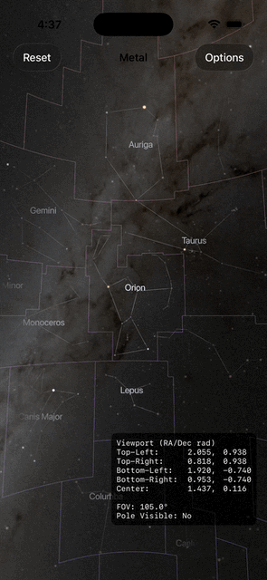

# StarryNight
High performance star catalog and constellation data layer backed by SQLite and H3 index to power planetarium and star charts.

## Features

- **Multi-level Detail Star Catalog**: Stars are grouped into 4 levels for different zoom levels: brightest 300 (up to mag 3.5), H3 level 0 (up to mag 6.1), H3 level 1 (up to mag 8.0), H3 level 2 (up to mag 21). At any time only up to ~300 of stars will be rendered within the viewport.
- **H3 Spatial Indexing**: Efficient spatial queries using Uber's H3 hexagonal hierarchical spatial index
- **Comprehensive Catalogs**: Includes Hipparcos, Henry Draper, Harvard Revised catalogs
- **Constellation Data**: Full IAU constellation boundaries and traditional connection lines
- **Star Names**: Proper names, Bayer-Flamsteed designations, and catalog numbers
- **Spectral Classification**: Stellar spectral types for accurate color rendering

## Planetarium



**Planetarium** is an interactive, Metal-driven star viewer built on top of StarryNight. It turns the star catalog into an immersive real-time planetarium experience for iOS and macOS.

- **Pan, zoom, and animate** across the night sky with momentum-based camera controls
- **Spectral-accurate star rendering** — stars are color-tinted by spectral class and scaled by brightness magnitude, rendered as instanced billboard quads
- **Constellation overlays** — connection lines, IAU boundary borders, and MSDF-rendered name labels
- **Star selection** — tap any star to see detailed info, with a crosshair indicator and off-screen navigation arrows to guide you to selected stars outside the viewport
- **Adaptive H3 spatial loading** — only the stars visible in the current viewport are rendered, keeping frame rates smooth even with millions of catalog entries

## Quick Start

### Swift Package Manager Integration

Add StarryNight to your project by adding the following dependency to your `Package.swift`:

```swift
dependencies: [
    .package(url: "https://github.com/DJBen/StarryNight.git", from: "1.0.0"),
]
```

Or add it through Xcode:
1. File → Add Package Dependencies
2. Enter the repository URL
3. Add to your target

### Basic Usage

```swift
import StarryNight

// Initialize the star manager
let starManager = StarManager()

// Get the brightest stars for display
let brightStars = starManager.brightestStars()

// Get stars up to magnitude 6.0 (naked eye limit)
let visibleStars = starManager.stars(maximumMagnitude: 6.0)

// Search for a specific star
let searchResults = starManager.searchStars(matching: "Sirius")

// Get detailed star information
if let starId = searchResults.first?.id {
    let starInfo = starManager.starInfo(forId: starId)
    print("Star: \(starInfo?.properName ?? "Unknown")")
}
```

### Common Query Examples

#### Working with Star Data

```swift
// Get stars for a specific view (viewport-based query)
let viewport = [
    (latitude: 40.0, longitude: -74.0),  // New York area
    (latitude: 41.0, longitude: -74.0),
    (latitude: 41.0, longitude: -73.0),
    (latitude: 40.0, longitude: -73.0)
]
let starsInView = starManager.stars(inViewport: viewport, maximumMagnitude: 5.0)

// Find the closest star to a coordinate
let coordinate = Vector(x: 0.5, y: 0.5, z: 0.7)
let nearestStar = starManager.closestStar(
    to: coordinate, 
    maximumMagnitude: 6.0, 
    maximumAngularDistance: 0.1
)

// Get stars by H3 spatial indexing
let h3Stars = starManager.stars(forH3Level: 2, maximumMagnitude: 4.0)
```

#### Working with Constellations

```swift
// Get all constellations
let allConstellations = starManager.allConstellations()

// Find a specific constellation
let orion = starManager.constellation(iau: "ORI")
let ursa = starManager.constellation(named: "Ursa Major")

// Get constellation connection lines for drawing
if let constellation = orion {
    let lines = starManager.constellationLines(for: constellation)
    // Use lines to draw constellation patterns
}

// Find neighboring constellations
if let constellation = orion {
    let neighbors = starManager.neighbors(for: constellation)
}
```

#### Star Naming and Identifiers

```swift
// Stars can have multiple naming systems
let star = starManager.star(withId: 12345)
if let starInfo = star?.info {
    print("Hipparcos: \(starInfo.hipparcos ?? 0)")
    print("Henry Draper: \(starInfo.henryDraper ?? 0)")
    print("Harvard Revised: \(starInfo.harvardRevised ?? 0)")
    print("Proper name: \(starInfo.properName ?? "None")")
    
    // Bayer-Flamsteed designations (e.g., "α Orionis")
    if let bf = starInfo.bayerFlamsteed {
        print("Designation: \(bf.description)")
    }
}
```

#### Performance Considerations

```swift
// For real-time applications, use appropriate magnitude limits
// Brightest 300 stars - always fast
let brightStars = starManager.brightestStars()

// For zoomed out views, use higher magnitude limits
let allVisibleStars = starManager.stars(maximumMagnitude: 6.0)

// For detailed views, you can go fainter but expect more data
let faintStars = starManager.stars(maximumMagnitude: 9.0)

// Use H3 indexing for spatial queries when possible
let localStars = starManager.stars(
    inH3Cell: "8428309ffffffff", 
    level: 2, 
    maximumMagnitude: 7.0
)
```

### Thread Safety

All StarManager operations are thread-safe and marked as `Sendable`. The underlying SQLite database supports concurrent reads.

## Sources and transformations
The stars DB comes from [HYG database](https://www.astronexus.com/projects/hyg), available as csv.

## License

StarryNight is available under the MIT license. See the LICENSE file for more info.

## Swift concurrency (3.2.0)

Reuse a `StarCatalog` actor. It opens the bundled database read-only on its own
executor, and returns checked `Sendable` values:

```swift
let catalog = StarCatalog()
let sky = try await catalog.snapshot(maximumMagnitude: 6)
// Draw using sky.stars, sky.constellations, sky.lines and sky.starsByID.
// Endpoints include stars fainter than the display limit.
let selected = sky.closestStar(to: direction, maximumAngularDistance: 0.05)
let info = try await catalog.starInfo(forID: selectedID)
```

Snapshot rendering and hit testing require no database access. The actor retains
one snapshot; callers can retain others as needed. Cancellation is checked before
and after snapshot loading; an in-flight synchronous SQLite query is allowed to
finish. The synchronous `StarManaging` API remains available for existing clients;
its final `StarManager` serializes entire operations (including cursor iteration
and bounded caches) with a recursive lock. Avoid synchronous queries on the main
actor. Legacy query methods retain their existing empty/nil-on-error behavior.

### Database maintenance

After rebuilding the HYG tables, run `python3 scripts/optimize_database.py` before
shipping the resource. This adds ID, catalog, constellation and compound H3/magnitude
indexes, gathers planner statistics and validates database integrity. Version
3.2.0 uses `PRAGMA user_version = 30200`; stellar source measurements are unchanged.

### Review and validation

- Added missing unique star ID indexes to prevent full scans for line endpoints.
- Batch-load constellation endpoints and cache immutable rendering snapshots.
- Open the bundled SQLite resource read-only; no startup migration or writes.
- Protect the legacy connection and caches across concurrent callers.
- Replace unchecked sendability on star/constellation values with compiler checks.
- Include magnitude boundaries consistently across all H3 tables.
- Correct cone selection across cell boundaries and poles. The old implementation
  passed degrees to H3 and restricted searches to a single cell. Direct legacy cone
  searches now scan magnitude-filtered candidates; use snapshots for repeated taps.
- Tests cover query plans, read-only enforcement, resource integrity, endpoints,
  boundaries, concurrent callers, cancellation and hit testing.

A local warm-cache comparison of 500 ID lookups in `stars_h3_2` (five repetitions,
median) took 752.55 ms before indexing and 2.07 ms after indexing. This is a query
microbenchmark, not a claim about end-to-end frame rate.
